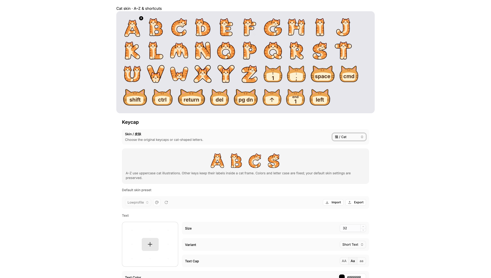
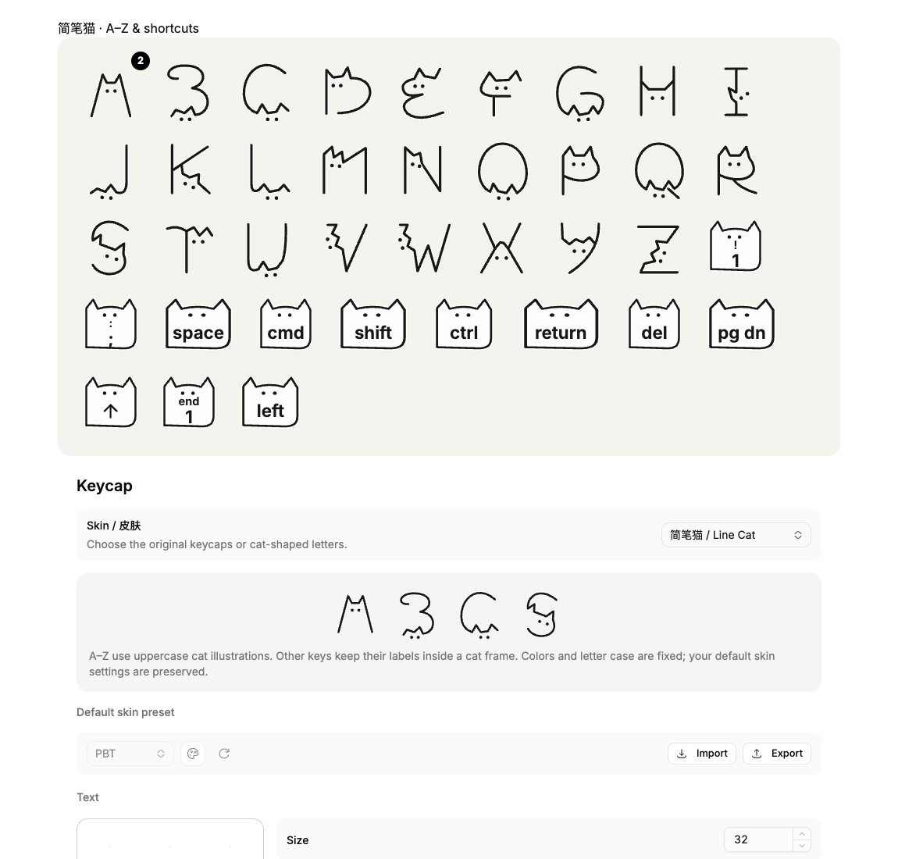
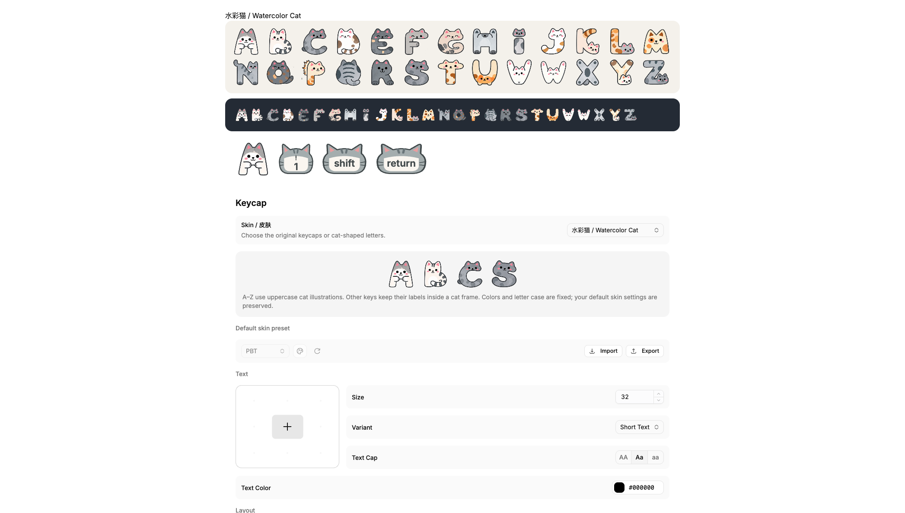

# [Keyviz](https://keyviz.org)

<div>
   
   
   
   
   
</div>

Keyviz is a **free and open-source** tool that visualizes your keypresses and mouse actions in real-time. Let your audience know what handy shortcuts you're pressing during tutorials, presentations, collaborations, or whenever you need.

## ⌨️ Keypress & 🖱️ Mouse Actions
Along with normal keys, you can also visualize mouse actions like <kbd>Cmd</kbd> + <kbd>Click</kbd>, <kbd>Alt</kbd> + <kbd>Drag</kbd>, etc.


Display mouse clicks and scroll wheel movements alongside your cursor.


</br>

## ⚙️ Full Customization
Don't settle for defaults. Every aspect of the visualization is under your control:
- **Styling:** Change colors (modifier vs. regular keys), size, layout, border, and background.
- **Filtering:** Control which keys are shown using hotkey or custom filters.
- **History:** Keep a visual trail of your recent inputs.
- **Position:** Move the visualization to any part of your screen.
- **Animations:** Customize how inputs appear and disappear with preset entry and exit animations.

</br>


### Cat skin

In **Keycap → Skin / 皮肤**, choose **猫 / Cat** to display A–Z as illustrated
orange cats shaped like uppercase letters. Numbers, punctuation, modifiers and
other keys keep their labels or icons inside a matching cat frame. Size, press
feedback and repeat counts remain available. The illustrations use fixed colors
and uppercase letter shapes; the original styling controls apply to the default
skin. Switching back to **默认 / Default** restores your existing keycap style.
The skin selection is saved and included in settings imports and exports; older
settings without a skin field use Default.



The transparent alphabet atlas is bundled at `public/skins/cat/alphabet.png`.
It was generated with the built-in image generation tool from the approved
A/B/C/S concept: rounded ginger cats whose bodies form readable uppercase
letters, dark brown outlines, cream accents, transparent background. The renderer
uses measured sprite bounds, so replacing the atlas requires updating those
bounds in `src/components/keycaps/cat.tsx`.

Choose **简笔猫 / Line Cat** for a second cat skin inspired by hand-drawn
cat alphabets: black open contours, triangular ears and two dot eyes. All 26
letters are SVG drawings, with a fine white edge for contrast on dark desktops.
Other keys use a matching monochrome cat frame. This skin shares the same size,
press feedback, repeat count and saved-selection behavior as the orange cats.



</br>

## 📥 Installation

### Windows & macOS
You can download the latest version of Keyviz from the **[GitHub Releases](https://github.com/mulaRahul/keyviz/releases)** page.

*   **Windows:** Download the `.msi` installer, run it, and follow the steps.
*   **macOS:** Download the `.dmg`. 
    **Note:** Keyviz requires **Input Monitoring** and **Accessibility** permissions. Enable them here:
    `Settings > Privacy & Security > Input Monitoring & Accessibility`

### Linux (x11)
Keyviz is compatible with Linux using the X11 protocol. Currently, you can try it out by following the build instructions below.

</br>

## 🛠️ Build Instructions

If you want to contribute or build the latest features from the source, ensure you have [Node.js](https://nodejs.org/) and [Tauri](https://v2.tauri.app/start) set up on your system.

1.  **Clone the repository:**
    ```bash
    git clone https://github.com/mulaRahul/keyviz.git
    cd keyviz
    ```

2.  **Install dependencies:**
    ```bash
    npm install
    ```

3.  **Build the executable:**
    ```bash
    npx tauri build
    ```

<br/>


## 💖 Support the Project

*   **Star the Repo:** It helps others discover the project!
*   **GitHub Sponsors:** [Sponsor @mularahul](https://github.com/sponsors/mulaRahul)
*   **Keyviz Pro:** Get access to exclusive features while supporting the development of this open-source project.

👉 **[Upgrade to Pro at keyviz.org/pro](https://keyviz.org/pro)**

</br>

---

  Built with 🦀 and ❤️ using <a href="https://v2.tauri.app/">Tauri</a>.

### Watercolor cat skin

Choose **水彩猫 / Watercolor Cat** in Settings → Keycap → Skin for the
fourth skin. Its transparent A–Z atlas was redrawn from the supplied reference
with crisp outlines, gray tabbies, cream ginger cats, and calico patches.
Numbers and special keys use a matching gray-and-cream cat frame. Selection,
settings imports/exports, size, press animation, and press counts are supported.



The 1374 × 1145 transparent PNG is bundled at
`public/skins/watercolor-cat/alphabet.png`. It was redrawn with the built-in
imagegen tool. Generation brief: faithfully redraw the reference cat alphabet
with sharp dark-gray outlines, pink ears and cheeks, gray/cream/calico coloring;
26 isolated glyphs in a six-column grid; transparent background and letter holes,
opaque white fur, consistent optical height, and no captions.
